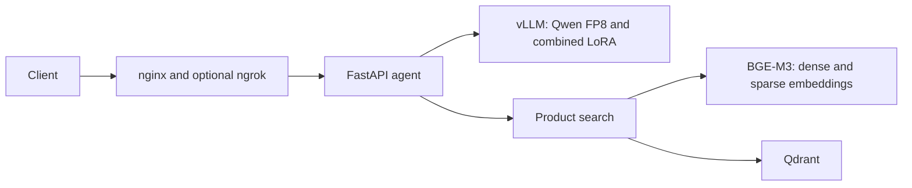

# Saulie

Saulie is a conversational sales agent I built for my Master's project in Data Science. It asks questions, identifies what the user needs, and searches a product catalog when it has enough context to make a recommendation.

I wanted to run the model and catalog locally, without calling a hosted language model for every message. The system uses Qwen3-4B-Instruct-2507, LoRA adapters, and hybrid retrieval, with a design budget of 12 GB of GPU memory.

## Training

The model is trained in two stages:

1. [Supervised fine-tuning](sft/README.md) teaches conversational steering from about 500 synthetic dialogues. The examples start with a problem, an unrelated question, a lifestyle situation, or a vague complaint. The model has to ask useful questions and reach a product category without waiting for an explicit shopping request.
2. [Direct preference optimization](dpo/README.md) refines that behavior using 522 chosen/rejected pairs. These target repetitive phrasing, weak steering, and poor product fit. The SFT adapter stays frozen while a separate DPO adapter trains on top of it.

Product names, prices, and links come from retrieval at inference time. Training recommendations use generic categories so the model learns how to recommend rather than memorizing an inventory.

## Architecture



The agent manages the conversation and executes `search_products` calls. BGE-M3 produces dense and sparse vectors in one pass, and Qdrant combines both rankings with reciprocal rank fusion. vLLM serves the FP8 base with a single adapter containing the SFT and DPO updates. Responses stream over SSE.

## Results

I evaluated generated conversations with two LLM judges, then used direct conversations to choose between the final candidates. Across 52 steering scenarios, mean scores averaged over both judges were 2.97/5 for the prompted base, 3.16 for SFT, and 3.32 for DPO. Judge A counted clean recommendations in 13, 20, and 27 of the 52 conversations respectively.

The deployed model is SFT trial 17 plus DPO v1.5 trial 4. Trial 4 was selected through conversational evaluation rather than the training objective. DPO improved direct-problem and vague-complaint openings most; SFT remained slightly better on unrelated and lifestyle openings. [Evaluation and results](docs/evaluation.md)

For retrieval, the McAuley catalog with RRF returned a relevant first result on 15/18 test queries. The local serving benchmark measured about 70.5 median decode tokens per second and a 2.49-second p95 tool turn. [Retrieval comparison](rag/fusion_comparison_report.md), [latency measurements](dpo/eval/LATENCY_REPORT.md)

## Setup

The stack runs under Ubuntu 22.04 in WSL2 with NVIDIA CUDA, Docker, and Conda. Model weights, trained adapters, and the product index must be supplied separately. Follow [the setup guide](REPRODUCIBILITY.md) before starting the services.

```bash
conda activate saulgman
bash start_saulie.sh
```

The default configuration uses `dpo-v15-trial-4`, the `compressed` system prompt, and the `amazon_products_v2` collection. [API usage and deployment](docs/deployment.md)

## Documentation

- [Development decisions](docs/project-history.md)
- [Data generation and preparation](docs/data.md)
- [SFT](sft/README.md) and [DPO](dpo/README.md)
- [Evaluation and results](docs/evaluation.md)
- [Conversation example](docs/examples.md)
- [Architecture](docs/architecture.md) and [product retrieval](rag/README.md)
- [Setup](REPRODUCIBILITY.md), [deployment](docs/deployment.md), and [security](SECURITY.md)
- [Limitations and further work](docs/limitations.md)

Training summaries, evaluation outputs, and the DPO dataset are included. To check their counts, hashes, and documentation links without starting GPU services:

```bash
python scripts/check_docs.py
```

## License

The code is under the [MIT license](LICENSE). External models and catalog data retain their own terms.
