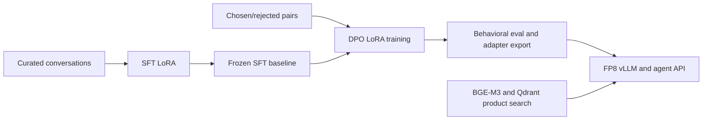

# Saulie

A conversational shopping agent built with supervised fine-tuning, direct preference optimization, and hybrid product retrieval. The project follows a small language model through data curation, training, behavioral evaluation, and a local API demo.

The trained model learns to ask useful questions and connect a user's needs to a generic product category. At runtime, a separate retrieval tool searches a catalog for specific items. Training conversational behavior and retrieving catalog facts are different parts of the system.

## The project in one minute

1. **Build the examples.** Iterate on synthetic conversations, then curate chosen/rejected preference pairs.
2. **SFT teaches the behavior.** Adapt Qwen3-4B-Instruct-2507 with LoRA. The later pipeline freezes `steering-sft-v1.1/trial-17` as its baseline.
3. **DPO refines preferences.** Train a separate LoRA against that frozen SFT reference using 522 repaired preference pairs. Score assistant tokens while keeping multi-turn user replies as context.
4. **Evaluate actual conversations.** Check ordinary chat, steering, fluency, adapter export, and the FP8 serving path. High preference accuracy alone did not guarantee usable English.
5. **Serve with retrieval.** Combine the SFT and selected DPO adapters into one LoRA for vLLM. A FastAPI agent calls BGE-M3 and Qdrant, then streams its response through an OpenAI-compatible API.



## Read the work in order

- [Project history](docs/project-history.md) traces the Windows Llama experiments, WSL Qwen training, DPO revisions, and deployment work.
- [Data preparation](docs/data.md) separates SFT conversations from DPO preference data and explains their versions.
- [SFT](sft/README.md) describes the training objective, masking, search, and frozen trial-17 baseline.
- [DPO](dpo/README.md) explains the reference policy, multi-turn scoring, experiments, and final adapter.
- [Evaluation and results](docs/evaluation.md) links saved outputs and explains what each measurement establishes.
- [Recorded conversation examples](docs/examples.md) compare base, SFT, and DPO on the same saved scenario.
- [Architecture](docs/architecture.md) and [deployment](docs/deployment.md) cover retrieval, tools, streaming, and configuration.
- [Reproducibility](REPRODUCIBILITY.md) separates inspecting evidence from running a stack that needs external artifacts.

## What the saved evidence shows

- SFT v1.1 has 20 completed trial summaries. Trial 16 had the lowest validation loss, `2.2194`; the DPO pipeline uses trial 17, `2.2227`. [SFT evidence](docs/evidence/sft-study-v1.1.json)
- The final DPO study recorded 21 completed trials across 31 attempts, with 11 unique completed configurations. Its numerical winner was trial 16. The author selected trial 4 for deployment after behavioral review. [Training summary](dpo/study_results/trial_summary_v1.5.json), [selection record](docs/evidence/selection-record.json)
- Round 1 contains seven models on 34 scenarios. A later comparison contains base, SFT, and deployed DPO outputs on all 60 scenarios. These are generated conversations, not published judge scorecards. [Evaluation details](docs/evaluation.md)
- In the saved 18-query retrieval comparison, McAuley with RRF scored 15/18 first-result matches against 10/18 for the Indian catalog. The scorer uses a keyword rubric. [Retrieval report](rag/fusion_comparison_report.md)
- An archived local benchmark recorded about 70.5 median decode tokens per second and a 2.49-second p95 tool turn. These are small-sample historical measurements. [Latency report](dpo/eval/LATENCY_REPORT.md)

## Inspect without a GPU

```bash
git clone https://github.com/MrenXX/Saulie.git
cd Saulie
python scripts/check_docs.py
```

Documentation, study summaries, synthetic evaluation conversations, and DPO data can be reviewed directly. Model weights, trained adapters, the SFT training file, and the product index are not distributed here.

To run the demo after supplying those artifacts, follow [the setup guide](REPRODUCIBILITY.md). The configured deployment is `dpo-v15-trial-4`, the `compressed` prompt, and `amazon_products_v2` with RRF.

## Scope and limits

Saulie is a local research and portfolio project. It is not a public hosted service or a validated production shopping system. Early Windows experiments used Llama-3.2-3B; the deployed model uses Qwen3-4B. The full GPU stack was not rebuilt during the documentation audit.

The historical SFT run logged a dataset hash that differs from the current local file. Structured final judge scorecards and a published BGE ONNX export recipe also remain missing. [The audit and remaining work](docs/documentation-audit.md) describe these limits.

`main` is the canonical project view. Older `deployment`, `dpo_eval`, and `rag` branches are historical focused snapshots. Code uses the [MIT license](LICENSE); external models and catalog data retain their own terms.
