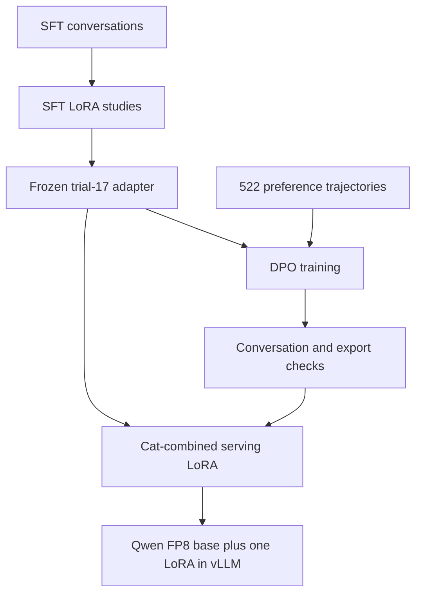
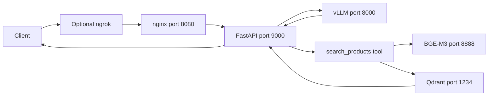

# Architecture

Saulie has an offline training pipeline and an online demo stack. The conversation model supplies language and steering behavior. Retrieval supplies catalog facts when the agent executes a tool.

## Model preparation

The final training policy adds DPO to frozen SFT behavior. Export combines their weight updates into one serving adapter. It does not retrain the base during deployment or store catalog products in the LoRA.

## Request path

Local clients can call the agent directly. nginx authenticates requests arriving through the optional tunnel. vLLM, BGE-M3, Qdrant, and nginx run in separate containers; the agent is a Python process on the host.

## Agent loop

[`agent_chat_api.py`](../agent_chat_api.py) sends history, a persona prompt, and a search-tool schema to vLLM. When the response contains a tool call, the agent searches, appends tool results, and requests a composed response.

I kept three system-prompt variants to tune serving behavior without retraining. `legacy` forces a rigid sales pattern, `steering` gives detailed rules, and `compressed` expresses the priorities more briefly. The shorter prompt worked best with the trained model and is the default.

`/v1/chat/completions` supports JSON and streaming. With streaming, text tokens pass through SSE. Tool arguments remain buffered until the call is complete. Keep-alive comments prevent idle model calls from causing the proxy or tunnel to close the connection. [Streaming details](../AGENT_STREAMING.md)

## Retrieval

[`rag/query2.py`](../rag/query2.py) requests dense and sparse BGE-M3 embeddings, retrieves both vector types from Qdrant, and combines rankings with RRF or DBSF. It can filter product category. ASINs reconstruct product links.

I chose BGE-M3 so one model could supply both vector types without a second encoder or reranker. The TensorRT engine has maximum batch two and sequence length 256. Indexing must honor those limits. The server also needs the sparse projection weights. [RAG setup](../rag/README.md)

## Tool pressure

Main includes [`saulie_tool_pressure.py`](../vllm_plugins/saulie_tool_pressure.py), a custom logits processor. The agent supplies settings through vLLM request metadata.

Defaults leave early turns unpressured, add bias from turn three, and force tool behavior from turn six. The agent sends these settings with inference requests; they do not change the adapter weights.

The [smoke report](../dpo/eval/matrix_runs/tool_pressure_smoke_report.md) shows more search execution in the camping and kitchen flows, with some searches earlier than intended. Those cases guide further tuning of the pressure schedule.

## Branches and paths

`main` is the documented implementation. Historical focused branches are not independent current releases. `fix/tool-pressure-reset-and-rag-gate` has additional reset and dense-cosine gate work that is not merged into main.

Scripts default to `/root/saulie`. `RAG_ROOT` and service settings are configurable, but some model and training paths need manual updates when moving the checkout. [Deployment](deployment.md)
